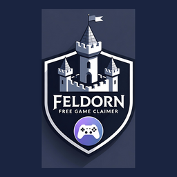
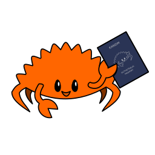

# unRAID-templates

Unraid Community Applications templates maintained by [ds-sebastian](https://github.com/ds-sebastian).

Install them from the **Apps** tab in Unraid by searching for the app name. Each template's Overview has the setup steps, required prerequisites and links.

## Templates

-  [Feldorns-Free-Games-Claimer](feldorns-free-games-claimer/feldorns-free-games-claimer.xml): `ghcr.io/feldorn/free-games-claimer:latest` · [project](https://github.com/feldorn/free-games-claimer)
-  [home-assistant-matter-hub](home-assistant-matter-hub/home-assistant-matter-hub.xml): `ghcr.io/riddix/home-assistant-matter-hub:latest` · [project](https://github.com/RiDDiX/home-assistant-matter-hub)
-  [kanidm](kanidm/kanidm.xml): `kanidm/server:latest` · [project](https://kanidm.com)
-  [Kokoro-FastAPI-GPU](kokoro-tts-gpu/kokoro-tts-gpu.xml): `ghcr.io/remsky/kokoro-fastapi-gpu:latest` · [project](https://github.com/remsky/Kokoro-FastAPI)
-  [LibreChat](librechat/librechat.xml): `ghcr.io/danny-avila/librechat:latest` · [project](https://www.librechat.ai)
-  [openbot](openbot/openbot.xml): `ghcr.io/nightly-labs/openbot:latest` · [project](https://openbot.run)
-  [OpenThreadBorderRouter-HA](OpenThreadBorderRouter-HA/OpenThreadBorderRouter-HA.xml): `ghcr.io/ownbee/hass-otbr-docker:latest` · [project](https://github.com/ownbee/hass-otbr-docker)
-  [openviking](openviking/openviking.xml): `ghcr.io/volcengine/openviking:latest` · [project](https://github.com/volcengine/OpenViking)
-  [OpenThread-Border-Router](otbr/otbr.xml): `openthread/border-router:stable` · [project](https://openthread.io/guides/border-router)
-  [pricecious](pricecious/pricecious.xml): `ghcr.io/ds-sebastian/pricecious:latest` · [project](https://github.com/ds-sebastian/pricecious)
-  [rreading-glasses](rreading-glasses/rreading-glasses.xml): `blampe/rreading-glasses:latest` · [project](https://github.com/blampe/rreading-glasses)
-  [voice-incubator](voice-incubator/voice-incubator.xml): `ghcr.io/ohf-voice/voice-incubator:latest` · [project](https://github.com/OHF-Voice/voice-incubator)
-  [wyoming-whisper](wyoming-whisper/wyoming-whisper.xml): `rhasspy/wyoming-whisper:latest` · [project](https://github.com/OHF-Voice/wyoming-faster-whisper)

## Notes

- Templates never contain credentials. Fill in tokens and passwords during install.
- An empty field is passed to the container as an empty variable. Settings where an empty value would change behaviour are left out of the templates and documented in the Overview instead.
- Problems with a template itself: open an issue here. Problems with an app: use the app's Support link.
